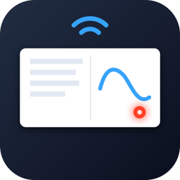
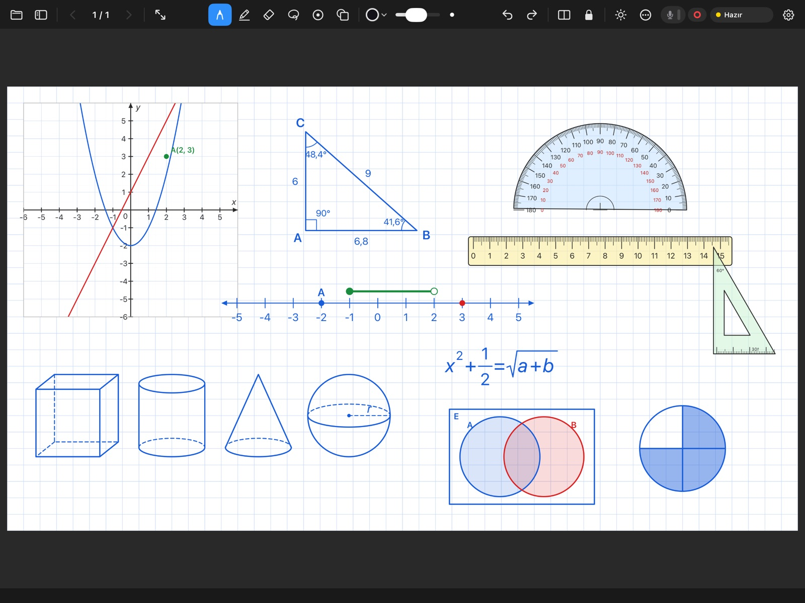
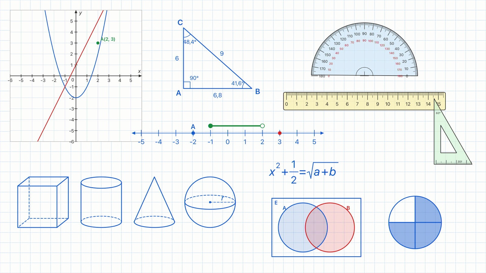
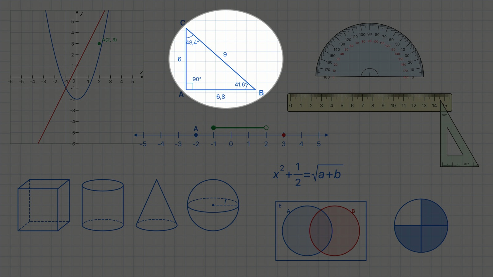
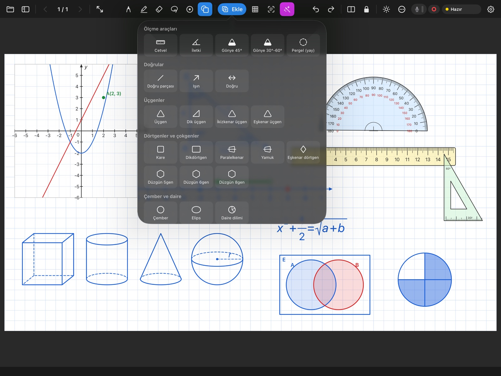
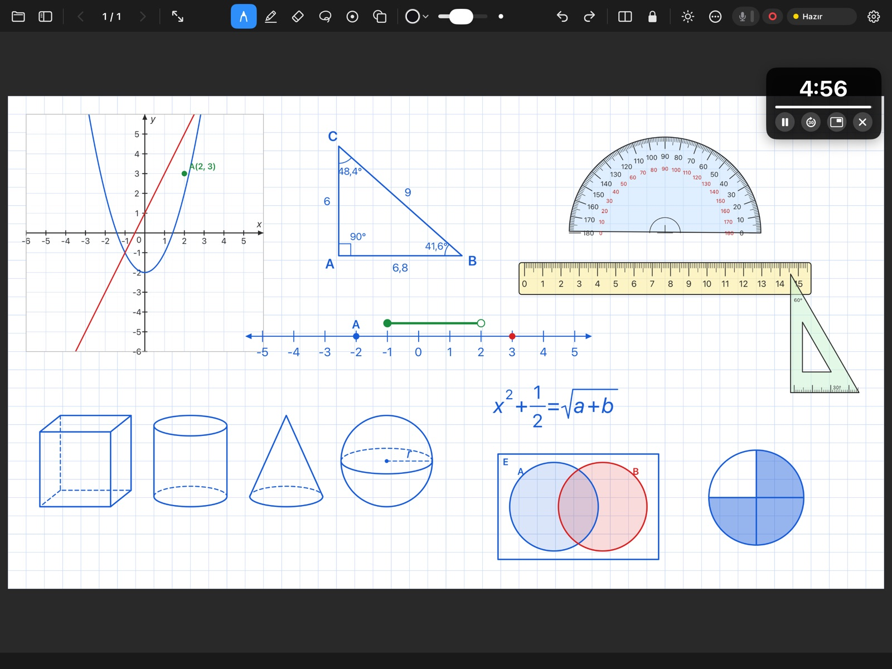
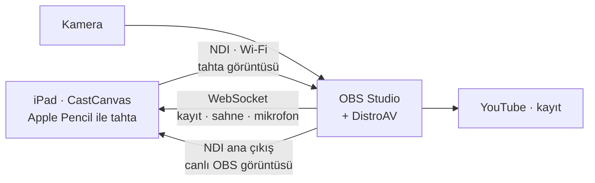
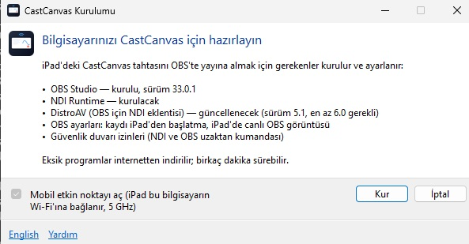
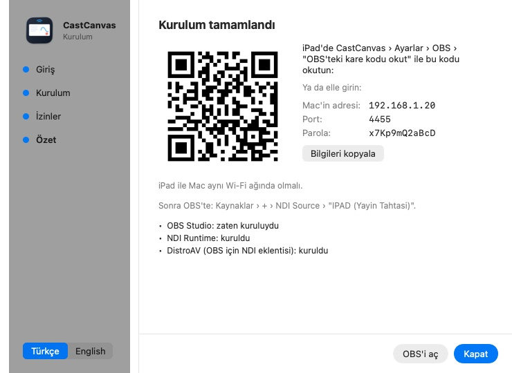
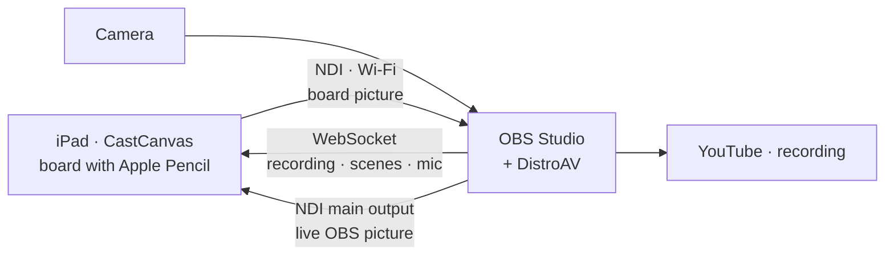

  

<h1 align="center">CastCanvas: Live Whiteboard</h1>

  <b>iPad'inizi OBS'te canlı ders tahtasına çevirin.</b> 
  <i>Turn your iPad into a live whiteboard in OBS.</i>

  
  &nbsp;
  

  <a href="#türkçe">Türkçe</a> · <a href="#english">English</a>

  

---

## Türkçe

### Nedir?

**CastCanvas**, iPad'de Apple Pencil ile yazdığınız tahtayı **kablosuz olarak OBS'e** gönderen bir ders yayını uygulamasıdır. Soru çözümü, ders anlatımı ve canlı yayınlar için tasarlandı. Kamera sahnenin bir yanında, tahta öbür yanında durur. Ekran paylaşımı, kablo ya da yakalama kartı gerekmez.

### Öne çıkanlar

- 📡 **Kablosuz ve keskin:** tahta OBS'e **NDI** ile gider, sahnenizdeki alanın tam piksel boyutunda (ör. 1280×1080). PDF ve yazılar bulanıklaşmaz. Ev Wi-Fi'ı ya da bilgisayarın etkin noktası yeterli.
- 🎛️ **OBS'i iPad'den yönetin:**
  - Kaydı başlatıp durdurun, sahne değiştirin.
  - Mikrofon seviyesini izleyin; sesiniz kesilirse uyarı alırsınız.
  - OBS'in canlı görüntüsü iPad'de küçük bir monitörde durur.
- 🔖 **Soru başına bölümler:** her soru kayıtta bir bölüm olur ve YouTube açıklaması için zaman listesi hazır gelir. İsterseniz her soru ayrı bir video olarak kaydedilir.
- 📐 **Matematik araçları:**
  - Ölçme araçları: cetvel, iletki, gönye, pergel.
  - Şekiller: üçgenler, çokgenler, 3B cisimler.
  - Grafikler: fonksiyon grafikli koordinat düzlemi, sayı doğrusu.
  - Diğer: Venn şeması, kesir modelleri, tablo, formül.
- ✍️ **Akıllı kalem:**
  - Kalemi bir an bekletince çizgi düzelir; daire, üçgen ve dikdörtgen kusursuz hâle gelir.
  - El yazısı formüle dönüşür.
- 🔦 **Ders araçları:**
  - İzleyicinin dikkatini tek noktaya çeken odak (tiyatro spotu) ve lazer işaretçi.
  - Yayında da görünen geri sayım.
  - Yayına gitmeyen gizli notlar ve ipucu gösterme.
  - Kareli, çizgili ve noktalı sayfa şablonları.
- 📄 **PDF üzerinde çalışma:** soru kitapçığını açıp üzerinde çözün. Çözülen sayfaları PDF ders notu olarak kaydedin, dersi diğer iPad'e taşıyın.
- ✅ **Yayın öncesi kontrol:** NDI, OBS, mikrofon, disk alanı ve kayıt ayarlarını tek ekranda görürsünüz.

### Ekran görüntüleri

<table>
  <tr>
    <td width="50%"> <b>Yayına giden kare:</b> izleyicinin OBS'te gördüğü tahta, araç çubukları olmadan.</td>
    <td width="50%"> <b>Odak:</b> tahtanın geri kalanı kararır, anlattığınız yer öne çıkar.</td>
  </tr>
  <tr>
    <td> <b>Şekil kütüphanesi:</b> ölçme araçları, üçgenler, çokgenler, çember, cisimler, grafikler.</td>
    <td> <b>Geri sayım:</b> öğrencilere süre verin. Sayaç yayında da görünür.</td>
  </tr>
</table>

### Nasıl çalışır?

### Bilgisayar kurulumu (tek adım)

Kurulum sihirbazı bilgisayarı tek seferde hazırlar:

- **OBS Studio**, **NDI Runtime** ve **DistroAV** (OBS için NDI eklentisi) kurulur. Kurulu olanlar atlanır, eski sürümler güncellenir.
- Programlar resmi kaynaklarından indirilir ve kurulmadan önce doğrulanır (SHA-256 özeti ve dijital imza).
- OBS iPad için ayarlanır: kaydı iPad'den başlatma (WebSocket) ve iPad'de canlı OBS görüntüsü (NDI ana çıkışı).
- **Windows:** güvenlik duvarı izinleri verilir. İsterseniz 5 GHz mobil etkin nokta da açılır.
- **Mac:** gerekli izinler (Yerel Ağ, Kamera, Mikrofon) tek tek gösterilir. Bitişte iPad'in okutacağı kare kod çıkar.

<table>
  <tr>
    <td width="50%"> <b>Windows:</b> kurulu olanları gösterir, eksikleri kurar.</td>
    <td width="50%"> <b>Mac:</b> bitişte iPad'in okutacağı kare kod.</td>
  </tr>
</table>

| | Windows 10/11 | macOS 12 ve üstü |
|---|---|---|
| 1 | [Zip'i indirin](https://github.com/alihdr2/CastCanvas/releases/latest/download/CastCanvas-Setup-Windows.zip). Sağ tık › **Tümünü ayıkla** | [Zip'i indirin](https://github.com/alihdr2/CastCanvas/releases/latest/download/CastCanvas-Setup-Mac.zip). Açılınca **CastCanvas Setup** uygulaması çıkar |
| 2 | **CastCanvas-Setup.exe**'ye çift tıklayın | Uygulamayı açın |
| 3 | Windows yönetici izni sorar: **Evet** | NDI kurulurken Mac parolanızı bir kez sorar |

> **"Bilgisayarınız korundu" / "Doğrulanamadı" uyarısı:** kurulum dosyaları henüz ücretli bir sertifikayla imzalanmadığı için çıkar. Bu sayfadan indirdiğiniz dosyalar güvenlidir.
> - **Windows:** **Ek bilgi** › **Yine de çalıştır**. Tarayıcı uyarırsa **Sakla** deyin.
> - **Mac:** uygulamayı bir kez açmayı deneyin, sonra **Sistem Ayarları › Gizlilik ve Güvenlik** › **Yine de Aç** deyin.

Kurulumdan sonra iPad'de **CastCanvas › Ayarlar › OBS** bölümünü açın ve kurulumun gösterdiği bilgileri girin (Mac'te kare kodu okutun). Sonra OBS'te kaynağı ekleyin: **Kaynaklar › + › NDI Source › "IPAD (Yayin Tahtasi)"**.

### Gereksinimler

- **iPad:** iPadOS 17 ya da üstü. Apple Pencil önerilir.
- **Bilgisayar:** Windows 10/11 ya da macOS 12 ve üstü. OBS Studio 31.1.1 ya da üstü gerekir; kurulum kendisi kurar.
- **Ağ:** iPad ile bilgisayar aynı ağda olmalı: aynı Wi-Fi ya da bilgisayarın mobil etkin noktası.

### iPad uygulaması

CastCanvas iPad uygulaması şu an deneme aşamasında. App Store bağlantısı yayınlanınca burada olacak.

---

## English

### What is it?

**CastCanvas** is a teaching app that sends the board you write on with Apple Pencil **wirelessly to OBS**. It's built for solving problems, teaching and live streams. Your camera sits on one side of the scene and the board on the other. No screen sharing, cables or capture card needed.

### Highlights

- 📡 **Wireless and sharp:** the board reaches OBS over **NDI** at the exact pixel size of its slot in your scene (e.g. 1280×1080). PDFs and handwriting stay crisp. Home Wi-Fi or your computer's hotspot is enough.
- 🎛️ **Control OBS from the iPad:**
  - Start and stop recording, switch scenes.
  - Watch your microphone level; you're warned if your audio drops out.
  - A small monitor on the iPad shows the live OBS picture.
- 🔖 **Chapters per question:** each question becomes a chapter in the recording, and a timestamp list for the YouTube description is ready when you stop. Optionally, each question is saved as its own video.
- 📐 **Math tools:**
  - Measuring: ruler, protractor, set squares, compass.
  - Shapes: triangles, polygons, 3D solids.
  - Graphs: coordinate plane with function graphs, number line.
  - More: Venn diagrams, fraction models, tables, formulas.
- ✍️ **Smart pen:**
  - Hold the pen for a moment to straighten a line; circles, triangles and rectangles snap into shape.
  - Handwriting becomes a formula.
- 🔦 **Teaching tools:**
  - A spotlight and a laser pointer to draw attention to one spot.
  - A countdown that also shows on stream.
  - Private notes that never go on air, and hint reveal.
  - Grid, lined and dotted page templates.
- 📄 **Work on PDFs:** open a workbook and solve on top of it. Save solved pages as PDF lesson notes and move a lesson to another iPad.
- ✅ **Pre-stream check:** NDI, OBS, microphone, disk space and recording settings on one screen.

### Screenshots

<table>
  <tr>
    <td width="50%"> <b>On air:</b> the board as viewers see it in OBS, without toolbars.</td>
    <td width="50%"> <b>Spotlight:</b> the rest of the board dims so the part you're explaining stands out.</td>
  </tr>
  <tr>
    <td> <b>Shape library:</b> measuring tools, triangles, polygons, circles, solids, graphs.</td>
    <td> <b>Countdown:</b> give students time. The timer shows on stream too.</td>
  </tr>
</table>

### How it works

### Computer setup (one step)

The setup wizard gets your computer ready in one go:

- Installs **OBS Studio**, **NDI Runtime** and **DistroAV** (the NDI plugin for OBS). Programs that are already installed are skipped; old versions are updated.
- Downloads each program from its official source and verifies it before installing (SHA-256 checksum and digital signature).
- Sets up OBS for the iPad: start recording from the iPad (WebSocket) and a live OBS picture on the iPad (NDI main output).
- **Windows:** adds the firewall permissions. Optionally, it turns on a 5 GHz Mobile Hotspot.
- **Mac:** walks you through the permissions OBS needs (Local Network, Camera, Microphone). At the end it shows a QR code for the iPad to scan.

| | Windows 10/11 | macOS 12 or later |
|---|---|---|
| 1 | [Download the zip](https://github.com/alihdr2/CastCanvas/releases/latest/download/CastCanvas-Setup-Windows.zip). Right-click › **Extract All** | [Download the zip](https://github.com/alihdr2/CastCanvas/releases/latest/download/CastCanvas-Setup-Mac.zip). Opening it gives you the **CastCanvas Setup** app |
| 2 | Double-click **CastCanvas-Setup.exe** | Open the app |
| 3 | Windows asks for administrator permission: **Yes** | Your Mac asks for your password once while NDI is installed |

> **"Windows protected your PC" / "cannot be verified" warning:** it appears because the setup files are not yet signed with a paid certificate. Files downloaded from this page are safe.
> - **Windows:** **More info** › **Run anyway**. If your browser warns you, choose **Keep**.
> - **Mac:** try to open the app once, then go to **System Settings › Privacy & Security** › **Open Anyway**.

After setup, open **CastCanvas › Settings › OBS** on the iPad and enter the details the setup shows (on a Mac, scan the QR code). Then add the source in OBS: **Sources › + › NDI Source › "IPAD (Yayin Tahtasi)"**.

### Requirements

- **iPad:** iPadOS 17 or later. Apple Pencil recommended.
- **Computer:** Windows 10/11 or macOS 12 or later. Needs OBS Studio 31.1.1 or later, which the setup installs for you.
- **Network:** the iPad and the computer must be on the same network: the same Wi-Fi or the computer's hotspot.

### The iPad app

The CastCanvas iPad app is currently in testing. The App Store link will appear here once it's published.

---

  <a href="PRIVACY.md">Gizlilik politikası · Privacy Policy</a> &nbsp;·&nbsp;
  <a href="TERMS.md">Kullanım koşulları · Terms of Use</a> &nbsp;·&nbsp;
  <a href="https://github.com/alihdr2/CastCanvas/issues">Destek · Support</a>

NDI® is a registered trademark of Vizrt NDI AB. CastCanvas is not an NDI product and is not endorsed by NDI; it is compatible with NDI. 
OBS Studio is a trademark of the OBS Project. CastCanvas is not affiliated with the OBS Project.

